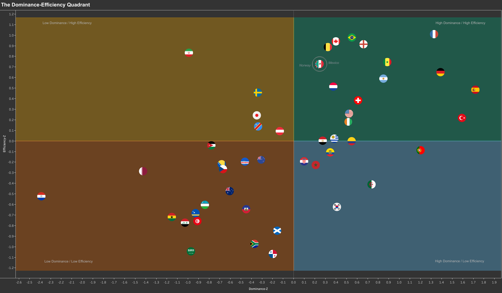

# Distilling Indicators: A Composite Approach to Performance Analysis
### Applied to FIFA World Cup 2026



*Dominance and Efficiency scores for all 48 teams. Mexico and Norway are circled because their near-identical profiles overlap.*

<p align="center">
  <a href="https://public.tableau.com/app/profile/yasin.tm/viz/TheDominanceEfficiencyQuadrantFIFAWorldCup2026/QuadrantMap"></a>
  <a href="https://www.kaggle.com/yasinetm"></a>
</p>

## Key Findings at a Glance

- **Dominance and Efficiency are related, but not interchangeable.** The two indices show a moderate positive correlation (r = 0.57). 36 of 48 teams sit on the same side of the average on both.
- **Both indices track tournament success.** Average finish improves steadily from the Below-Average/Below-Average quadrant to the Above-Average/Above-Average quadrant. Except Morocco, all top 8 teams sit in the top quadrant.
- **Dominance matters more for placement.** Losing Dominance consistently costs more placement than losing Efficiency. 
- **Paraguay** ranked last in Dominance, yet reached the Round of 16. Türkiye ranked second, but went out in the group stage.

## Table of Contents

- [Introduction](#introduction)
- [Dataset](#dataset)
- [Data Preparation & Validation](#data-preparation--validation)
- [Methodology](#methodology)
  - [Metric Selection](#metric-selection)
  - [Opponent-Strength Normalization](#opponent-strength-normalization)
  - [Metric Adjustment](#metric-adjustment)
  - [Standardization](#standardization)
  - [Index Construction](#index-construction)
  - [Quadrant Mapping](#quadrant-mapping)
- [Results](#results)
  - [Dominance and Efficiency](#dominance-and-efficiency)
  - [Quadrants and Placement](#quadrants-and-placement)
  - [Correlation Matrix](#correlation-matrix)
  - [Robustness Checks](#robustness-checks)
- [Limitations & Future Work](#limitations--future-work)
- [Tools & Repository Structure](#tools--repository-structure)
- [Credits & License](#credits--license)

## Introduction

This project explores official team performance data from the 2026 FIFA World Cup to investigate two age-old questions: Does dominance lead to efficiency? Is dominance actually necessary for tournament success?

As in most contexts, raw metrics can be misleading. I deliberately selected a small set of pertinent indicators for two composite indices. Dominance measures control of possession and territory, while Efficiency measures how well a team turns its opportunities into concrete output.

Next, I adjusted each team's metrics for opponent strength and standardized them as z-scores. This puts every metric on a common scale and enables a more informed comparison across groups and tournament stages.

Finally, I mapped each team into one of four quadrants, based on whether it scored above or below the tournament average on each index. I then examined how the two indices relate to each other and to each team's final placement.


## Dataset
**Performance data:** [FIFA's Training Centre](https://www.fifatrainingcentre.com/en/fifa-world-cup-2026/match-report-hub.php) published its official post-match reports as PDFs. [Alamyy](https://github.com/Alamyy) converted them into [tables](https://github.com/Alamyy/Worldcup26) covering all 104 matches and 48 teams (CC BY 4.0).

**Team strength data:** Opponent strength is based on FIFA's official World Ranking points as of the 11 June 2026 update, i.e., *just before the tournament*. I sourced them from [Kamil Kucharski](https://github.com/kamil-kucharski)'s [world-cup-2026-prediction repository](https://github.com/kamil-kucharski/world-cup-2026-prediction).

**Tournament results:** Final placements are based on [FIFA's official standings](https://www.fifa.com/en/tournaments/mens/worldcup/canadamexicousa2026/standings). Group-stage exits are ranked primarily by points, then goal difference, then goals scored. Teams eliminated in the same knockout round share a placement.

## Data Preparation & Validation
- Verified total counts for matches, teams, and metrics.
- Spot-checked 30 records from each dataset against FIFA's official sources.
- Standardized team names across the two source datasets to enable accurate joins.
- Built a final-placement table for all 48 teams to compare the quadrants with tournament outcomes.

## Methodology
### Metric Selection

Dominance measures control of possession and territory. I paired widely used indicators, such as possession and pass completion, with complementary ones that add more depth: moving the ball upfield, breaking lines, building up under pressure and reaching the final third.

Efficiency measures how well a team converts possession into chances and goals. It rewards teams that do more with less, not teams that simply have more.

> **_Note_:**
*All definitions come from [FIFA's Enhanced Football Intelligence documentation](https://www.fifatrainingcentre.com/media/native/tournaments/womens-world-cup/2023/FIFA%20Enhanced%20Football%20Intelligence%20(EFI)%20Explainations_EN%20v1.1.pdf), in line with the logic and language of FIFA's match reports.*

#### Dominance Index (6 metrics)

| Metric | Calculation | Meaning |
|---|---|---|
| Possession % | Average of per-match possession % | Share of the ball while in play |
| Pass Completion Rate | Average of per-match (completed ÷ total passes) × 100 | Passing reliability |
| Completed Line Breaks | Average completed line breaks per match | Penetration through defensive lines |
| Build Up Opposed % | Average share of possession spent in opposed build-up | Building up against pressure |
| Progression % | Average share of possession spent in the Progression phase | Advancing toward the final third |
| Final Third % | Average share of possession spent in the Final Third phase | Attacking in the final third |

#### Efficiency Index (4 metrics)

| Metric | Calculation | Meaning |
|---|---|---|
| xG per Attempt | Total xG ÷ total Attempts | Quality of chances per attempt |
| Goals per xG | Total goals ÷ total xG | Finishing relative to chance quality |
| Attempts per 100 Passes | (Total Attempts ÷ total passes) × 100 | Shot generation relative to passing volume |
| xG per Possession | Total xG ÷ summed possession % across matches | Danger generated per point of possession |

> **_Note_:**
*Dominance metrics use per-match averages, so every match counts equally. Efficiency metrics use tournament totals, so matches with more chances carry more weight and the ratios are less affected by noise in a single game.*

### Opponent-Strength Normalization

FIFA's World Ranking is an Elo-based measure of relative team quality. For each team, I averaged the ranking points of all opponents it faced and compared that average to the mean across all 48 qualified teams. The result is a multiplier that reflects how demanding each team's schedule was. A value above 1 means a tougher-than-average schedule, while a value below 1 means an easier one. Across the 48 teams, multipliers range from 0.94 to 1.08.

### Metric Adjustment

I applied each team's multiplier to its metrics. The adjustment keeps the tournament average fixed and scales each team's distance from it:

`Adjusted = k + (Raw − k) × Multiplier`

Here, *k* is the tournament average of the metric, *Raw* is the team's original value, and *Multiplier* is the team's opponent-strength multiplier from the previous step.

A multiplier above 1 widens a team's gap from the average, and a multiplier below 1 narrows it. A team that faced tougher opponents therefore sees its distance from the average magnified, while a team that faced easier opponents sees it shrink. Because the multipliers sit between 0.94 and 1.08, the adjustment is modest. It refines the comparison without overriding what happened on the pitch.

The adjustment is also symmetric around the average, so a below-average value against tough opponents moves slightly further below the average. However, the effect stays small with multipliers this close to 1.

Percentage metrics were clipped to the 0-100 range, so the adjustment can never produce an impossible value.

### Standardization

The adjusted values for all ten metrics were converted into z-scores. This allows metrics measured on different scales, such as possession percentage and Goals per xG, to be compared directly:

`z = (Adjusted − mean) ÷ standard deviation`

A z-score places each team relative to the tournament average on that metric.

### Index Construction

I averaged the z-scores within each index to produce two overall scores per team.

Every metric carries equal weight. This keeps the indices transparent and avoids arbitrary weighting choices.

Zero marks the average of the 48 teams on each index and divides the quadrants. A negative score means a team fell below that average, not that it performed poorly in absolute terms.

### Quadrant Mapping

Teams are positioned on a two-by-two matrix defined by their Dominance and Efficiency scores, resulting in four performance archetypes. This surfaces patterns not visible in either index alone.

| Quadrant | Interpretation |
|---|---|
| Above-Average Dominance / Above-Average Efficiency | Controls the game and turns control into output |
| Above-Average Dominance / Below-Average Efficiency | Controls the game but does less with it |
| Below-Average Dominance / Above-Average Efficiency | Controls less of the game but makes the most of its chances |
| Below-Average Dominance / Below-Average Efficiency | Falls short on both |

## Results

Paraguay ranked last of 48 teams on Dominance, yet it reached the Round of 16. It finished best in the Below-Average/Below-Average quadrant by a wide margin, and its run shows why this section describes trends, not rules.

### Dominance and Efficiency

The two indices show a moderate positive correlation (Pearson r = 0.57). Teams that control the game tend to turn that control into output. 36 of the 48 teams fall on the same side of the average on both indices, and 12 do not.

### Quadrants and Placement

I counted the teams in each quadrant and compared their average and best placement.

| Quadrant | Teams | Average placement | Best placement |
|---|---|---|---|
| Above-Average Dominance / Above-Average Efficiency | 18 | 11.7 | 1 |
| Above-Average Dominance / Below-Average Efficiency | 7 | 15.4 | 5 |
| Below-Average Dominance / Above-Average Efficiency | 5 | 20.2 | 17 |
| Below-Average Dominance / Below-Average Efficiency | 18 | 33.4 | 9 |

The Below-Average Dominance / Above-Average Efficiency quadrant holds only five teams, so its average deserves caution.

Dominance carries more weight than Efficiency. Losing Dominance consistently costs more placement than losing Efficiency. The pattern holds from both sides of the quadrant.

Average placement worsens steadily from the top quadrant to the bottom one. Spain, the champion, sits in the top quadrant. Paraguay has the best placement in the bottom quadrant, but it holds the worst Dominance score in the dataset.

Except for Morocco (AAD/BAE), seven of the eight quarterfinalists sit in the Above-Average/Above-Average quadrant. Spain won the title with the highest Dominance score of all 48 teams, but its Efficiency score (0.48) ranked only 13th.

Türkiye is another outlier. It posted the second-highest Dominance score (1.59), yet it went out in the group stage. Its Efficiency score (0.21) sits just above average, but that rests mostly on shot generation (2.05). In fact, its attempts were low in quality (xG per Attempt z = −0.69), and it finished them poorly (Goals per xG z = −1.20).

### Correlation Matrix
A correlation matrix of the ten metrics shows how much each index's metrics overlap.

Possession, Pass Completion, Completed Line Breaks and Build Up Opposed correlate at 0.75 to 0.88 with each other. Final Third is at 0.46 to 0.81. Dominance metrics go hand-in-hand to establish the definition of a team's "control".

Three of the four Efficiency metrics are nearly independent. xG per Attempt, Goals per xG and Attempts per 100 Passes correlate at |r| ≤ 0.16. Goals per xG is close to zero (−0.16 to 0.00). The Efficiency index captures multiple distinct types of output. xG per Possession has its own story as detailed below.

### Robustness Checks
Two metrics are not fully corrected for match length: Completed Line Breaks (a raw count) and xG per Possession (a count divided by a share). Teams that played extra time (9 matches out of 104) may gain a slight advantage. To test sensitivity, I rebuilt each index without its affected metric.

- **Dominance Index:** The rebuilt index matches the original almost perfectly (Pearson r = 0.997, Spearman ρ = 0.996). The Dominance-Efficiency correlation barely moves, from 0.567 to 0.573.

- **Efficiency Index:** The rebuilt index is less stable. It stays closely aligned with the original (Pearson r = 0.960, Spearman ρ = 0.961), but about half the teams move more than two ranks. The Dominance-Efficiency correlation falls from 0.567 to 0.449.

  The Correlation Matrix clarifies this impact. xG per Possession is a "bridge" metric between the two indices. It correlates 0.74 with xG per Attempt, 0.72 with Final Third, 0.65 with Completed Line Breaks and 0.54 with possession.

  Still, the quadrant conclusions hold with this rebuilt Index. Average placement continues to improve steadily, from about 35 in the bottom quadrant to about 12 in the top quadrant. Losing Dominance still costs more placement than losing Efficiency.


## Limitations & Future Work

- **One tournament is a small sample.** The insights pertaining to the questions in the Introduction describe what happened at FIFA World Cup 2026. Analyzing more World Cup editions would give a much clearer view.
- **Indices can hide opposite signals.** Averaging metrics lets strong and weak components offset each other. Türkiye is a perfect example, as detailed in Results. Reading the individual metrics shows which strengths and weaknesses an index conceals.
- **Match length is not fully corrected for two metrics.** Completed Line Breaks and xG per Possession may slightly favor teams that played extra time. The Robustness Checks section tests this.
- **Efficiency overlaps with Dominance by design.** xG per Possession and xG per Attempt correlate with the Dominance metrics, so part of the link between the indices comes from shared content, not from dominance leading to efficiency.

**Future work:** extend the analysis to previous World Cup editions, and apply per-90 corrections if minutes-played data becomes available.

## Tools & Repository Structure

- **SQL (DuckDB):** data preparation, metric calculation, opponent adjustment, standardization, index construction, quadrant mapping, placement comparison and robustness checks.
- **MotherDuck:** cloud hosting for the DuckDB database and query execution.
- **Tableau:** the quadrant scatter plot, the Dominance distribution chart and flag-based team markers.
- **Python:** the background image for the quadrant plot, with a colored fill for each quadrant, and the correlation matrix of the ten metrics.

```
wc26-dominance-v-efficiency-analysis/
├── README.md
├── LICENSE
├── requirements.txt
├── data/
│   ├── README.md
│   ├── dominance_z_scores.csv
│   ├── efficiency_z_scores.csv
│   ├── team_multiplier.csv
│   └── wc_final_analysis.csv
├── sql/
│   ├── 01_staging.sql
│   ├── 02_aggregation.sql
│   ├── 03_adjustment.sql
│   ├── 04_indexes.sql
│   └── 05_analysis.sql
│   └── 06_robustness.sql
├── python/
│   ├── corr_matrix.py
│   ├── quadrant_plot.py
└── figures/
    ├── quadrant_plot.png
    └── quadrant_background.png
    └── correlation_matrix.png
```
## Credits & License

This work builds on the public sources listed in [Dataset](#dataset).

This project is independent and has no affiliation with FIFA.

The code and analysis in this repository are released under the [MIT License](LICENSE). The source data keeps the licenses of its original providers.


